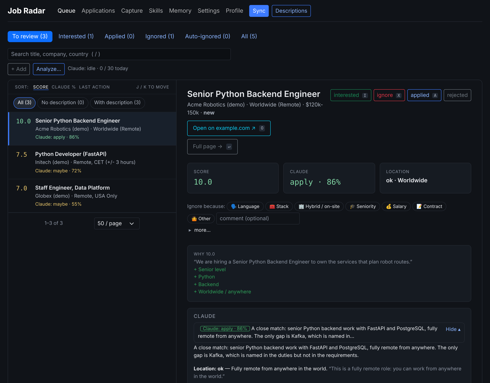
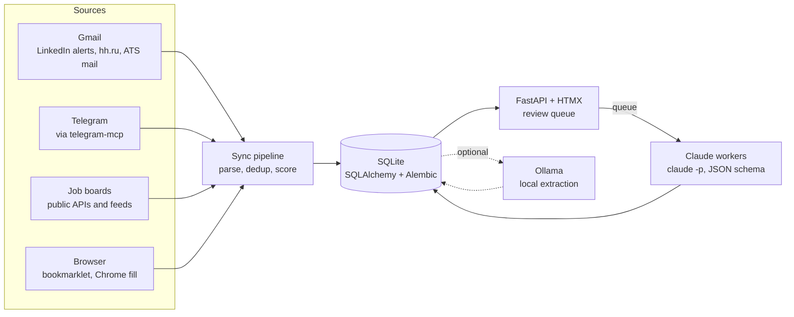

# Job Radar

[](https://github.com/dremdem/job-radar/actions/workflows/ci.yml)
[](https://github.com/dremdem/job-radar/actions/workflows/security.yml)
[](https://scorecard.dev/viewer/?uri=github.com/dremdem/job-radar)
[](LICENSE)

A local-first assistant for a job search. It collects vacancies from a dozen sources, scores them with an explanation for every point, asks an LLM for a grounded second opinion on the ones worth a look, and keeps the whole history with each company in one place.

I built it for my own search for a remote Senior Python Backend role and use it every day. Everything runs on my machine: a SQLite file, a FastAPI app on `127.0.0.1`, no cloud account.



**Human in the loop.** Job Radar reads and suggests. It never applies, never writes to recruiters, never logs in to LinkedIn or hh.ru, and never changes mail.

## What it does

- **Collects** vacancies from LinkedIn alert emails and hh.ru notifications (read-only Gmail), Telegram channels (through an MCP server), and public APIs and feeds: Himalayas, Hacker News "Who is hiring?", Remote OK, Jobicy, Remotive, Working Nomads, We Work Remotely.
- **Stores** each vacancy once per source (re-running an import never duplicates it), with every description snapshot kept; a repost of a vacancy you already applied to is folded into the original.
- **Scores** each one with rules (title, seniority, location, Python in the description), each rule adding a visible reason.
- **Analyzes** the promising ones with Claude: verdict, match %, strengths, gaps, red flags, questions for the recruiter, all with quotes that are checked against the vacancy text.
- **Tracks** applications, rejections and recruiter mail per company, recognized from ATS emails (Greenhouse, Lever, Ashby, Workable and more).
- **Shows the skills gap**: which missing technologies would open the most vacancies.
- **Auto-ignores** what you already said no to (hybrid, wrong country, already applied), always with the reason.

## How AI is used

Two models, each with a narrow job, and code that checks what they say.

| | Local model (Ollama, `gemma3:4b`) | Claude (Claude Code in headless mode) |
|---|---|---|
| Job | Extract work mode and residence rules from a description | Deep analysis of a vacancy against the CV and profile; a chat about it |
| Where it runs | On the machine, nothing leaves it | `claude -p` on a Claude subscription, no API key |
| Output | Fixed JSON fields, each with an exact quote | JSON validated by a `--json-schema` |
| Guard | A fact whose quote is not in the text is dropped | Quotes not found in the text are shown as *unverified* |

Design decisions worth a look:

- **The model extracts, code decides** ([docs/ai.md](docs/ai.md)). The LLM never sets a score or a state directly. It returns facts with quotes, code verifies each quote against the source text, and only then turns it into a reason. Small models invent sentences; this catches it.
- **Prompt injection from vacancy text** ([docs/claude.md](docs/claude.md#how-it-runs)). A description is untrusted input. Analyses run with no tools at all (`--tools ""`, no MCP, no settings), so a planted instruction has nothing to call. The chat may search the web, but LinkedIn and hh.ru are denied by Claude Code's own permission rules, and the switch is in Settings.
- **No surprise bills.** `ANTHROPIC_API_KEY` is removed from the subprocess environment, so it can never fall back to paid API usage. A daily cap counts running analyses too.
- **A worker pool with honest failure handling** ([job_radar/claude/analysis.py](job_radar/claude/analysis.py)). 1–8 parallel workers claim vacancies atomically; transient errors are retried with backoff and a fresh session; a usage-limit answer pauses the queue for 15 minutes instead of hammering; a restart puts unfinished work back.
- **Sessions and memory.** Each analysis is a Claude session that the chat resumes (`--resume`). Facts Claude learns about you are kept in a small memory with a change log you can edit ([docs/claude-memory.md](docs/claude-memory.md)).
- **Measured, not assumed.** The local model was turned off by default after comparing it with Claude on 64 vacancies: it added cost and filtered nothing Claude missed ([docs/ai.md](docs/ai.md#off-by-default-223)).

The project itself is built with an AI coding agent under explicit rules: every change starts from an issue, goes through a PR with tests first, and must pass CI. The rules the agent follows are in [CLAUDE.md](CLAUDE.md); the non-obvious decisions are in [docs/adr/](docs/adr/).

## Architecture



Python 3.12, FastAPI, Jinja2 + HTMX, SQLAlchemy 2, Alembic, SQLite, `uv`, `ruff`, `pytest`. More in [docs/architecture.md](docs/architecture.md).

## Quick start

Requires [uv](https://docs.astral.sh/uv/).

```sh
git clone https://github.com/dremdem/job-radar && cd job-radar
uv sync
uv run job-radar db upgrade   # create the SQLite database in data/
uv run job-radar demo         # demo vacancies with sample analyses, no Claude call
uv run job-radar serve        # http://127.0.0.1:8000
```

Real sources need their own setup: Gmail OAuth ([docs/gmail.md](docs/gmail.md)), Telegram MCP ([docs/telegram.md](docs/telegram.md)), Claude Code logged in ([docs/claude.md](docs/claude.md)), Ollama ([docs/ai.md](docs/ai.md)). The public job boards work out of the box. All commands, settings and the `./jr` helper: [docs/usage.md](docs/usage.md).

## Quality

- 700+ tests, run in parallel in under 20 s; fixtures only, no network, no real sleeps. Real emails used as fixtures go through [a sanitizer](tests/fixtures/sanitize.py) and tests that fail on personal data.
- CI on every PR and on `main`: `ruff`, `ruff format`, `pytest`.
- Security workflow on every PR, on `main` and weekly: gitleaks and trufflehog over the full history, `pip-audit` on the locked dependencies, `bandit`, CodeQL. The workflows themselves are checked by `zizmor` and `actionlint`, and every action is pinned to a commit SHA.
- [OpenSSF Scorecard](https://scorecard.dev/viewer/?uri=github.com/dremdem/job-radar) rates the repository's supply-chain practices on every change to `main`. Dependabot keeps dependencies and actions current. How to report a vulnerability: [SECURITY.md](SECURITY.md).

## Documentation

| Topic | |
|---|---|
| Using it | [usage](docs/usage.md) · [queue](docs/queue.md) · [settings](docs/settings.md) · [skills gap](docs/skills.md) |
| AI | [local model](docs/ai.md) · [Claude analysis](docs/claude.md) · [Claude memory](docs/claude-memory.md) |
| Sources | [Gmail](docs/gmail.md) · [LinkedIn alerts](docs/linkedin-alerts.md) · [hh.ru](docs/hh.md) · [Telegram](docs/telegram.md) · [boards](docs/boards.md) · [Himalayas](docs/himalayas.md) · [Hacker News](docs/hackernews.md) · [Remote OK](docs/remoteok.md) · [Jobicy](docs/jobicy.md) |
| Internals | [architecture](docs/architecture.md) · [data model](docs/data-model.md) · [applications](docs/applications.md) · [ADRs](docs/adr/) |

## License

[MIT](LICENSE)
