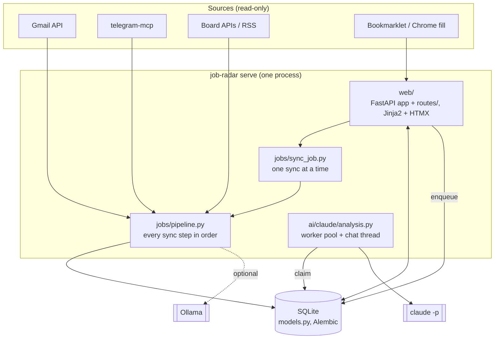
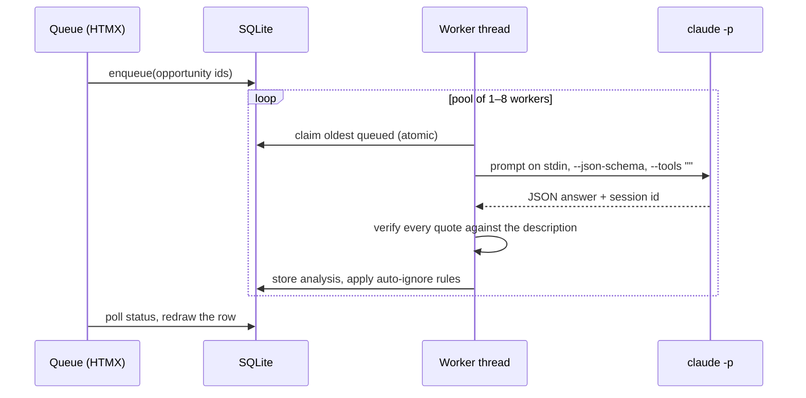

# Architecture

Job Radar is one Python process: a FastAPI app that serves the UI and runs background jobs in threads, over one SQLite file. There is no queue server, no cache and no container: the whole state is `data/` (the database, Claude sessions, logs) plus `.env` and `secrets/`.



## A vacancy's path

1. **Arrives.** A source module parses its input into a plain dataclass: an alert email (`sources/linkedin/alerts.py`), an hh.ru digest (`sources/hh/digests.py`), a Telegram post (`sources/telegram/posts.py`), a board API page (`sources/boards/himalayas.py`, `sources/boards/feeds.py`, …), or a page the user sends with the bookmarklet (`sources/linkedin/capture.py`, `sources/hh/capture.py`).
2. **Is stored once.** `dedup.py` upserts idempotently: one `Company` per normalized name (legal suffixes dropped, aliases), one `SourceRecord` per source and external id, one `JobSnapshot` per distinct description (by SHA-256). Re-running any import never creates duplicates. The same vacancy seen in two different sources stays two opportunities; only a repost of a vacancy already applied to (same company, same title) is merged into it (`review/applied_duplicates.py`).
3. **Is scored.** `scoring/rules.py` gives 0–10 from title and location, every rule leaving a `Reason`. `scoring/description.py` adds Python-in-description checks; `review/notes.py` and `history/rejections.py` adjust for what the user said and what companies answered.
4. **Is filtered.** `review/auto_ignore.py` moves noise out of *To review* (hybrid, country-only, Claude said skip, …), each with the rule's name; `review/applied_duplicates.py` attaches a repost of a vacancy already applied to.
5. **Is analyzed.** With a description, it is queued for Claude (`ai/claude/analysis.py`). Optionally the local model extracts work mode and residence first (`ai/local/analysis.py`); `scoring/findings.py` reads what it stored.
6. **Is decided by the user** in the queue: interested, ignore with a reason, applied. Mail about it later lands in the company history (`history/contacts.py`, `history/applications.py`).

## Sync

`jobs/pipeline.py` holds every step; the CLI (`job-radar sync gmail`) and the **Sync** button (`jobs/sync_job.py`) run the same list. Each step reports through one `echo` callback, so the terminal and the web status show the same lines. A failing source is reported and skipped; the others go on. Details: [queue.md](queue.md#sync).

## Claude analysis



- `ai/claude/prompt.py` builds the prompt (CV, profile, fixed facts, the vacancy) and the answer's JSON schema; `PROMPT_VERSION` is stored with each answer.
- `ai/claude/runner.py` is the only place that starts the CLI: environment without API keys, timeouts, transient-error detection.
- `ai/claude/analysis.py` owns the queue: claiming, retries with backoff, the daily cap, the 15-minute pause on a usage limit, re-queueing unfinished work at startup.
- `ai/claude/memory.py` keeps facts Claude learned about the user between chats, with a change log.

Everything that talks to the outside world sits behind a small `Protocol` (`Model`, `Runner`, board and Gmail clients), so tests pass fakes and never touch the network.

## Database

One SQLite file, `data/job_radar.db`, shared by the web requests and the background threads (Sync, up to four Claude analyses, the chat). `db.make_engine` sets up every connection:

- `journal_mode=WAL`: changes go to a write-ahead log first, so reading and writing no longer block each other. A page opens while an analysis is being saved, and a commit does not wait for open reads. Two writers still take turns.
- `busy_timeout=30000`: a writer that finds the database busy waits up to 30 s instead of failing with `database is locked` at once.
- `foreign_keys=ON`: SQLite does not enforce foreign keys by default.

WAL keeps two files next to the database, `job_radar.db-wal` and `job_radar.db-shm`. They belong to the database: never delete them. Recent changes can live only in `-wal` until SQLite copies them into the main file, so a plain `cp` of `job_radar.db` while the server runs can miss them. Back up with SQLite's backup API instead, which is safe while the server runs:

```sh
uv run python -c "import sqlite3; sqlite3.connect('data/job_radar.db').backup(sqlite3.connect('data/job_radar.db.bak'))"
```

(or `sqlite3 data/job_radar.db ".backup data/job_radar.db.bak"` if the `sqlite3` tool is installed).

## Layers

The packages of `job_radar` are ordered. A module imports only from lines below its own; names on one line do not import each other. Imports inside functions count too.

```
web  cli
jobs  demo
sources
ai  history
review
scoring
profile
dedup
models  db  config  mail
```

Why the order holds: sources store a vacancy and then call the rules (`review`) and record rejections (`history`); `ai` analyzes and then calls the rules; the rules read stored findings through `scoring/findings.py` and never call a model or a source; `jobs` runs all of them; `web` and `cli` only start things and show them. `tests/test_layers.py` checks it on every run, so a new import that points up fails CI.

## Modules

| Layer | Module | What it is |
|---|---|---|
| web, cli | `cli.py` (`job-radar`), `web/` | Entry points. `web/app.py` builds the app, `routes/` has one router per feature (queue, claude, settings, jobs, capture, applications), `context.py` builds what the templates show, `templating.py` holds the Jinja environment, `deps.py` the dependencies of the routes. `./jr` is a shell helper |
| jobs, demo | `jobs/` | Background work: `pipeline.py` (every sync step in order), `sync_job.py`, `description_job.py`. `demo.py` fills a demo database |
| sources | `sources/` | Everything that brings vacancies and mail in: `gmail/`, `linkedin/`, `hh/`, `telegram/`, `boards/` (`himalayas`, `hackernews`, `remoteok`, `jobicy`, `fdetimes`, `feeds`), `manual.py`, the shared `titles.py` and `http.py`, and `capture_read.js` (the page reader of the bookmarklet and the Chrome fill) |
| ai | `ai/` | `local/` (Ollama), `claude/` (Claude Code), `skills.py` (skills gap report) |
| history | `history/` | `applications.py`, `rejections.py`, `contacts.py` |
| review | `review/` | The queue: `auto_ignore.py`, `applied_duplicates.py`, `notes.py`, `suggestions.py` |
| scoring | `scoring/` | Checks that need no model and no decision: `rules.py`, `description.py`, `language.py`, `findings.py` |
| profile | `profile/` | Who the user is: `home.py`, `stack.py` |
| dedup | `dedup.py` | Idempotent upserts |
| models, db, config, mail | `models.py`, `db.py`, `config.py`, `mail.py`, `migrations/` (Alembic) | Storage, settings and the mail port (`FetchBody`, `MessageGone`: what importers need from Gmail) |

The database schema is described in [data-model.md](data-model.md).

## Testing

`tests/` mirrors the modules. Sources are tested on recorded fixtures (`tests/fixtures/`); real emails are sanitized first (`tests/fixtures/sanitize.py`) and privacy tests fail on names, addresses and tracking tokens. Each test gets its own SQLite file migrated with Alembic (`tests/conftest.py`). The suite runs in parallel with `pytest-xdist`.
