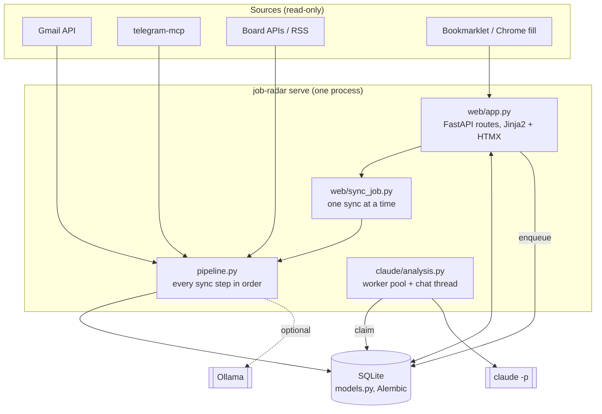
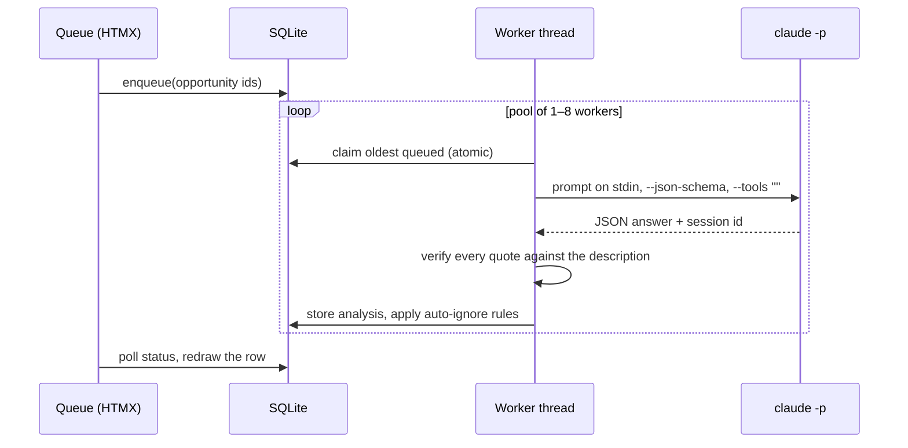

# Architecture

Job Radar is one Python process: a FastAPI app that serves the UI and runs background jobs in threads, over one SQLite file. There is no queue server, no cache and no container: the whole state is `data/` (the database, Claude sessions, logs) plus `.env` and `secrets/`.

## A vacancy's path

1. **Arrives.** A source module parses its input into a plain dataclass: an alert email (`linkedin/alerts.py`), an hh.ru digest (`hh/digests.py`), a Telegram post (`telegram/posts.py`), a board API page (`himalayas.py`, `boards.py`, …), or a page the user sends with the bookmarklet (`linkedin/capture.py`, `hh/capture.py`).
2. **Is stored once.** `dedup.py` upserts idempotently: one `Company` per normalized name (legal suffixes dropped, aliases), one `SourceRecord` per source and external id, one `JobSnapshot` per distinct description (by SHA-256). Re-running any import never creates duplicates. The same vacancy seen in two different sources stays two opportunities; only a repost of a vacancy already applied to (same company, same title) is merged into it (`applied_duplicates.py`).
3. **Is scored.** `scoring.py` gives 0–10 from title and location, every rule leaving a `Reason`. `description.py` adds Python-in-description checks; `notes.py` and `rejections.py` adjust for what the user said and what companies answered.
4. **Is filtered.** `auto_ignore.py` moves noise out of *To review* (hybrid, country-only, Claude said skip, …), each with the rule's name; `applied_duplicates.py` attaches a repost of a vacancy already applied to.
5. **Is analyzed.** With a description, it is queued for Claude (`claude/analysis.py`). Optionally the local model extracts work mode and residence first (`ai/analysis.py`).
6. **Is decided by the user** in the queue: interested, ignore with a reason, applied. Mail about it later lands in the company history (`contacts.py`, `applications.py`).

## Sync

`pipeline.py` holds every step; the CLI (`job-radar sync gmail`) and the **Sync** button (`web/sync_job.py`) run the same list. Each step reports through one `echo` callback, so the terminal and the web status show the same lines. A failing source is reported and skipped; the others go on. Details: [queue.md](queue.md#sync).

## Claude analysis

- `claude/prompt.py` builds the prompt (CV, profile, fixed facts, the vacancy) and the answer's JSON schema; `PROMPT_VERSION` is stored with each answer.
- `claude/runner.py` is the only place that starts the CLI: environment without API keys, timeouts, transient-error detection.
- `claude/analysis.py` owns the queue: claiming, retries with backoff, the daily cap, the 15-minute pause on a usage limit, re-queueing unfinished work at startup.
- `claude/memory.py` keeps facts Claude learned about the user between chats, with a change log.

Everything that talks to the outside world sits behind a small `Protocol` (`Model`, `Runner`, board and Gmail clients), so tests pass fakes and never touch the network.

## Modules

| Area | Modules |
|---|---|
| Entry points | `cli.py` (`job-radar`), `web/app.py`, `./jr` (shell helper) |
| Storage | `models.py`, `db.py`, `dedup.py`, `migrations/` (Alembic) |
| Sources | `gmail/`, `linkedin/`, `hh/`, `telegram/`, `himalayas.py`, `hackernews.py`, `remoteok.py`, `jobicy.py`, `boards.py`, `manual.py` |
| Scoring and filters | `scoring.py`, `description.py`, `language.py`, `stack.py`, `notes.py`, `suggestions.py`, `auto_ignore.py`, `applied_duplicates.py` |
| History | `applications.py`, `rejections.py`, `contacts.py` |
| AI | `ai/` (Ollama), `claude/` (Claude Code), `skills.py` (skills gap report) |
| Background jobs | `pipeline.py`, `web/sync_job.py`, `web/description_job.py` |

The database schema is described in [data-model.md](data-model.md).

## Testing

`tests/` mirrors the modules. Sources are tested on recorded fixtures (`tests/fixtures/`); real emails are sanitized first (`tests/fixtures/sanitize.py`) and privacy tests fail on names, addresses and tracking tokens. Each test gets its own SQLite file migrated with Alembic (`tests/conftest.py`). The suite runs in parallel with `pytest-xdist`.
